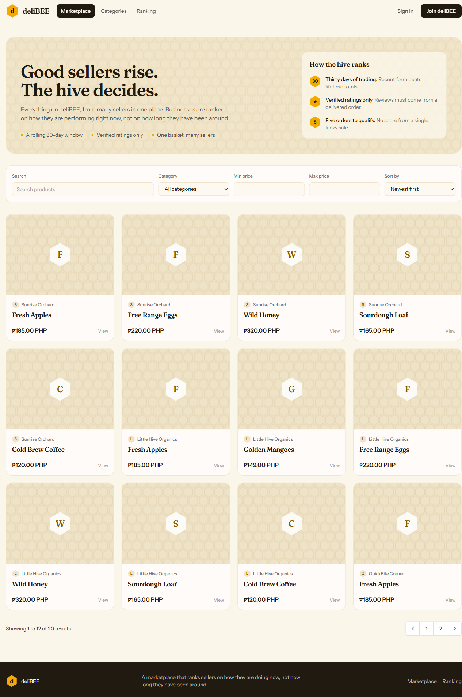
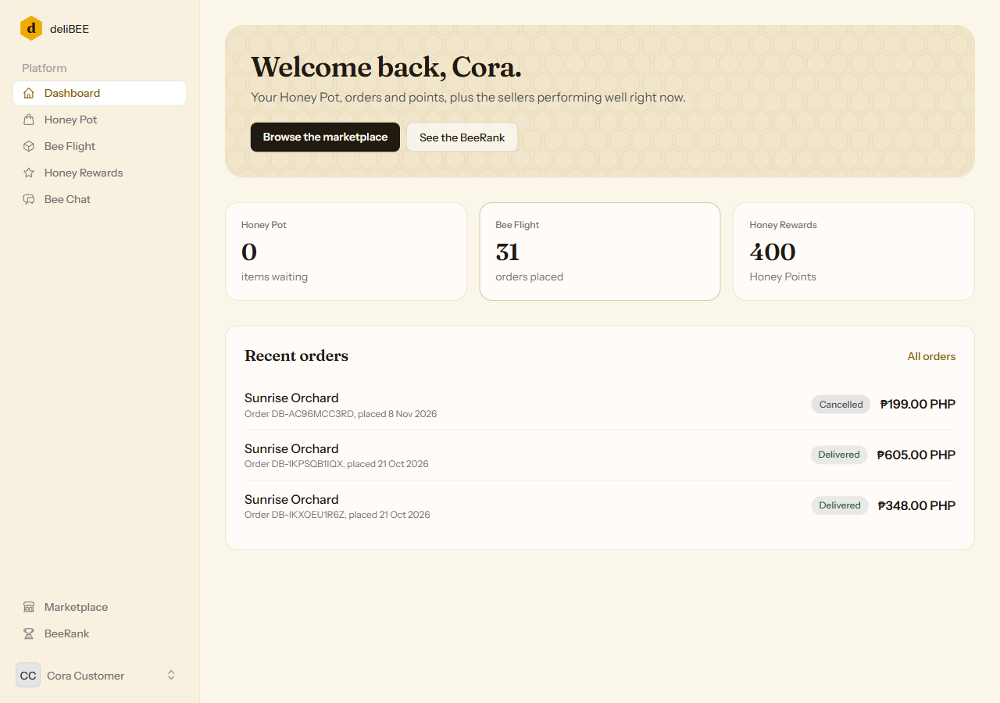
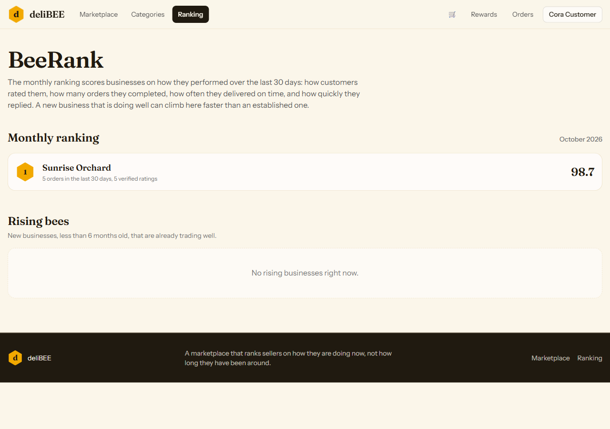
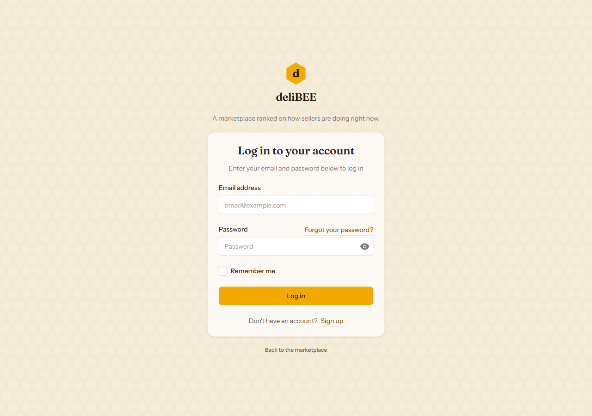

# deliBEE

A multi-vendor marketplace where sellers are ranked on **how they are performing now**, not on lifetime totals.

[](https://github.com/charantadatanan/Delibee/actions/workflows/ci.yml)



## What it does

- **Marketplace** — full-text product search, category and price filters, sorting, seller storefronts.
- **BeeRank** — a rolling 30-day score built from verified ratings, order completion, on-time delivery and chat response time. Monthly snapshots are published, plus a *Rising Bees* list for young sellers already trading well.
- **Honey Pot** — one cart across many sellers; checkout splits it into one order per seller. Product rows are locked during checkout so stock cannot oversell.
- **Honey Points** — an append-only ledger (welcome bonus, purchases, reviews, refund reversals), never a stored balance.
- **Verified reviews** — only delivered purchases can rate, one review per purchased item, and only verified ratings feed BeeRank.
- **Bee Chat** — customer/seller messaging with per-conversation response tracking.
- **Seller desk** — store onboarding and admin approval, product management, and an order-fulfilment timeline.
- **Warm Hive design system** — Fraunces + Instrument Sans, a honeycomb-derived visual language, light/dark mode, responsive down to mobile.

## Stack

| Layer | Choice |
|---|---|
| Backend | Laravel 13, PHP 8.4 |
| UI | Livewire 4 single-file components, Flux, Tailwind CSS 4 |
| Database | PostgreSQL 18 (search via `tsvector`, `pg_trgm`) |
| Assets | Vite 8, Bunny-hosted Fraunces + Instrument Sans |
| Quality | Pest 5, Larastan (level 7), Pint |

## Screenshots

| Dashboard | BeeRank |
|---|---|
|  |  |



## Getting started

Requirements: PHP 8.4, Composer, Node 24, PostgreSQL 16+.

```bash
git clone https://github.com/charantadatanan/Delibee.git
cd Delibee
composer install
cp .env.example .env
php artisan key:generate
```

Create the database configured in `.env`, then:

```bash
php artisan migrate --seed
npm install
npm run build
php artisan serve
```

`.env.example` expects PostgreSQL on `127.0.0.1:5432` with the user `delibee`; adjust the `DB_*` values to your local setup.

### Demo accounts

`DatabaseSeeder` loads demo data outside production only. All demo users use the password `password`:

- `admin@delibee.test` — administrator
- `customer@delibee.test` — customer with order history
- `test@example.com` — plain verified user

Seller accounts are generated with fake emails; use the admin account to approve sellers or create one through the onboarding flow.

## Admin operations

Admins get a **Hive Guard** page at `/admin/businesses` (linked in the sidebar) to review pending shops, approve them, suspend active sellers, and reactivate suspended ones.

The same actions are available from the CLI:

```bash
php artisan business:status sunrise-orchard active
php artisan business:status sunrise-orchard suspended
```

Statuses are `pending`, `active` and `suspended`; the command looks the business up by slug.

## Database backups

Create a compressed, custom-format PostgreSQL dump in `storage/backups` and prune dumps older than 14 days:

```powershell
powershell -ExecutionPolicy Bypass -File scripts\backup-database.ps1
```

Options: `-OutputDir`, `-KeepDays`, and `-PgDump` (defaults to the PostgreSQL 18 Windows path). The script reads `DB_*` from `.env`.

To restore, create a fresh database and restore into it (do not restore over the live one):

```powershell
# adjust paths/credentials to your environment
createdb -h 127.0.0.1 -p 5432 -U postgres -O delibee delibee_restore
pg_restore -h 127.0.0.1 -p 5432 -U delibee -d delibee_restore storage\backups\delibee-YYYYMMDD-HHMMSS.dump
```

Schedule the backup with Windows Task Scheduler (or cron on Linux) before relying on the database for anything important.

## Quality gates

```bash
php artisan test                   # Pest feature + unit suite
vendor/bin/pint --test             # coding style
vendor/bin/phpstan analyse         # Larastan, level 7
```

GitHub Actions runs the same checks against a PostgreSQL service on every push and pull request.

## Project layout

```
app/
  Models/ Enums/ Policies/ Services/ Support/    domain logic
  Livewire/Storefront/                           public Livewire components
resources/views/pages/                           Livewire 4 single-file pages
resources/views/components/storefront/           storefront shell + cards
resources/css/app.css                            Warm Hive design tokens
database/migrations/                             schema, indexes, search columns
tests/Feature/                                   domain + page-render coverage
docs/screenshots/                                README screenshots
.github/workflows/ci.yml                         CI pipeline
```

## Business rules worth knowing

- Checkout creates one order per seller and charges flat shipping once per order.
- Stock is checked under `lockForUpdate` inside the order transaction.
- Cancelling an order restores stock and reverses the purchase points exactly once.
- BeeRank ignores businesses that have not reached the minimum order count; components without data are dropped and weights renormalised.
- Publishing a ranking is transactional and replaces the whole period, so a business that drops out cannot keep a stale rank.
- Suspended or pending businesses and their products are hidden from the storefront and rankings.

## Status

- 90 tests (89 passing, 1 skipped — two-factor authentication is disabled in this build), 203 assertions.
- PHPStan level 7: 0 errors. Pint: clean.
- Payment is offline for now; launch currency, seller payout model and the payment gateway remain open product decisions.

## License

No license has been chosen yet. Add one before accepting external contributions.
