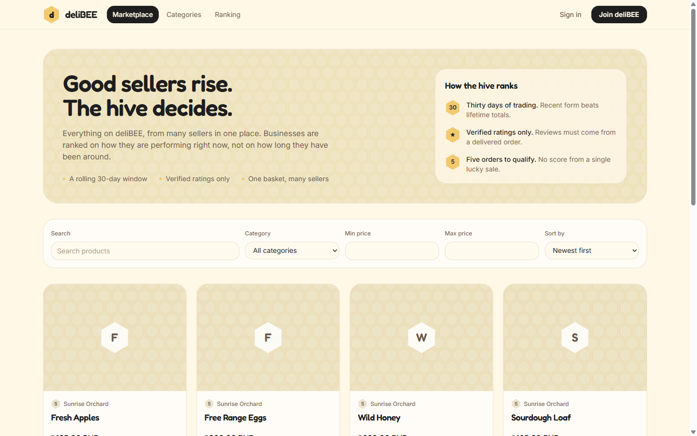
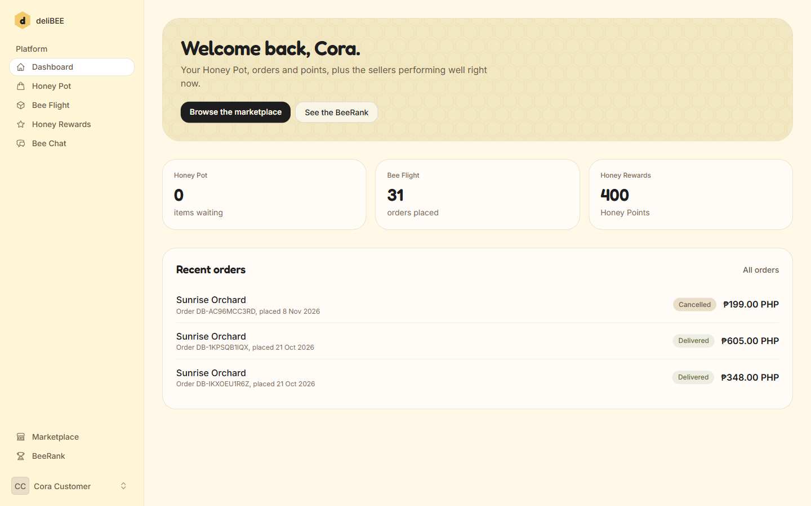
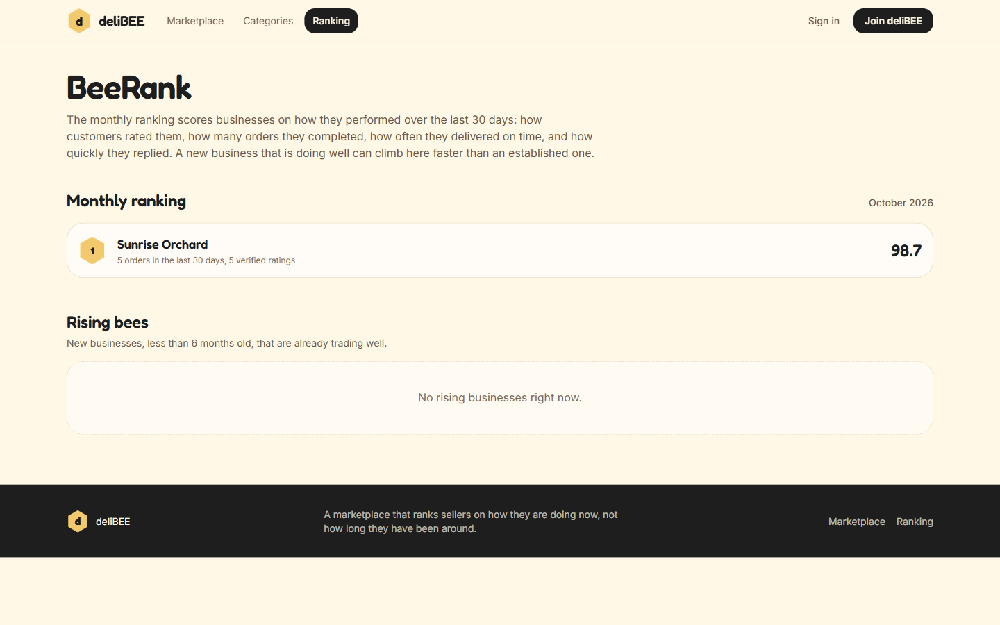
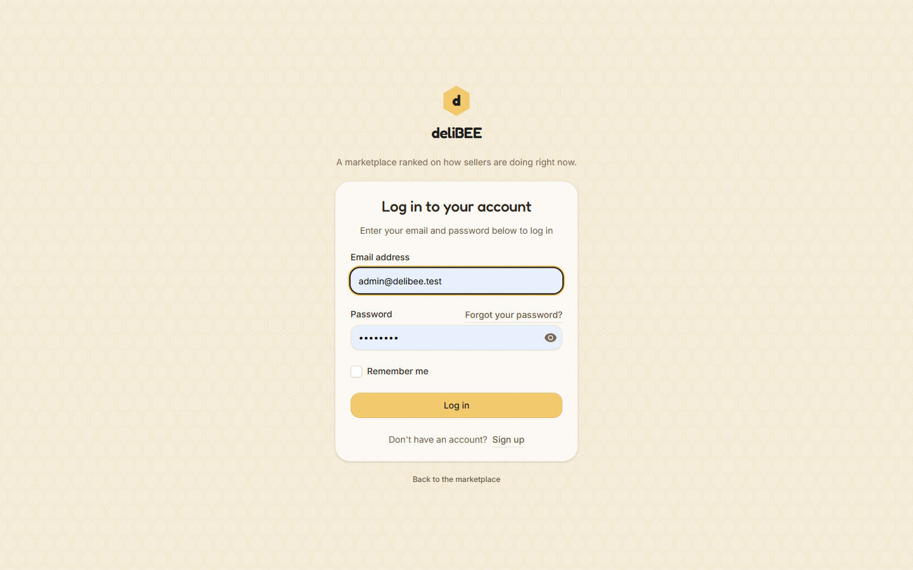

d# deliBEE

A multi-vendor marketplace where sellers are ranked on **how they are performing now**, not on lifetime totals.

[](https://github.com/charantadatanan/Delibee/actions/workflows/ci.yml)



## What it does

- **Marketplace** — full-text product search, category and price filters, sorting, seller storefronts.
- **BeeRank** — a rolling 30-day score built from verified ratings, order completion, on-time delivery and chat response time. Monthly snapshots are published, plus a *Rising Bees* list for young sellers already trading well.
- **Honey Pot** — one cart across many sellers; checkout splits it into one order per seller. Product rows are locked during checkout so stock cannot oversell.
- **Honey Points** — an append-only ledger (welcome bonus, purchases, reviews, refund reversals), never a stored balance.
- **Verified reviews** — only delivered purchases can rate, one review per purchased item, and only verified ratings feed BeeRank.
- **Bee Chat** — customer/seller messaging with per-conversation response tracking and per-user rate limiting.
- **Seller desk** — store onboarding and admin approval, product management, and an order-fulfilment timeline.
- **Hive Guard** — admin approval and suspension of sellers, order oversight, and review moderation.
- **deliBEE UI theme** — Fredoka + Inter, a cream-and-honey palette drawn from the Figma UI project, honeycomb motifs, light/dark mode, responsive down to mobile.

## Stack

| Layer | Choice |
|---|---|
| Backend | Laravel 13, PHP 8.4 |
| UI | Livewire 4 single-file components, Flux, Tailwind CSS 4 |
| Database | PostgreSQL 18 (search via `tsvector`, `pg_trgm`) |
| Assets | Vite 8, Bunny-hosted Inter + Fredoka |
| Quality | Pest 5, Larastan (level 8), Pint |

## Screenshots

| Dashboard | BeeRank |
|---|---|
|  |  |



### Theme options

The previous Warm Hive theme is preserved for comparison and rollback:

- Old screenshots: `docs/screenshots/` (`marketplace.png`, `dashboard.png`, `ranking.png`, `login.png`)
- Backup branch: `ui-backup/warm-hive` (tag `ui-warm-hive-2026-11-12`)
- Token reference: `docs/archive/theme-warm-hive.md`

## Getting started

Requirements: PHP 8.4, Composer, Node 24, PostgreSQL 16+.

```bash
git clone https://github.com/charantadatanan/Delibee.git
cd Delibee
composer install
cp .env.example .env
php artisan key:generate
```

Create the database configured in `.env`, then:

```bash
php artisan migrate --seed
npm install
npm run build
php artisan serve
```

`.env.example` expects PostgreSQL on `127.0.0.1:5432` with the user `delibee`; adjust the `DB_*` values to your local setup.

### Demo accounts

`DatabaseSeeder` loads demo data outside production only. All demo users use the password `password`:

- `admin@delibee.test` — administrator
- `customer@delibee.test` — customer with order history
- `test@example.com` — plain verified user

Seller accounts are generated with fake emails; use the admin account to approve sellers or create one through the onboarding flow.

## Admin operations

Admins get two **Hive Guard** pages in the sidebar:

- `/admin/businesses` — review pending shops, approve them, suspend active sellers, and reactivate suspended ones.
- `/admin/orders` — browse every order, filter by status or business, and open an order to review or cancel it.
- `/admin/reviews` — hide ratings that break the rules or republish them. Hidden reviews stay on record but no longer count towards storefront ratings or BeeRank.

The same actions are available from the CLI:

```bash
php artisan business:status sunrise-orchard active
php artisan business:status sunrise-orchard suspended
```

Statuses are `pending`, `active` and `suspended`; the command looks the business up by slug.

## Database backups

Create a compressed, custom-format PostgreSQL dump in `storage/backups`, verify it with `pg_restore --list`, and prune dumps older than 14 days:

```powershell
powershell -ExecutionPolicy Bypass -File scripts\backup\backup-database.ps1
```

Options: `-OutputDir`, `-OffsiteDir`, `-KeepDays`, `-PgDump` and `-PgRestore` (both default to the PostgreSQL 18 Windows path; `-PgRestore` is resolved next to `-PgDump`). The script reads `DB_*` from `.env` and deletes a dump that fails verification.

On Linux or macOS, `scripts/backup/backup-database.sh` reads the same `.env` and verifies dumps the same way:

```bash
./scripts/backup/backup-database.sh --output-dir /var/backups/delibee --keep-days 30
```

Options: `--output-dir`, `--offsite-dir`, `--keep-days`, `--pg-dump` and `--pg-restore`; the binaries default to `pg_dump`/`pg_restore` on `PATH`. A cron entry such as `0 21 * * * cd /srv/delibee && ./scripts/backup/backup-database.sh >> storage/logs/backup.log 2>&1` runs it nightly.

Both scripts can also copy the verified dump to an off-site folder (`-OffsiteDir`, `--offsite-dir`, or `BACKUP_OFFSITE_DIR`) — point it at a synced OneDrive folder, network share or USB drive. The copy is hash-verified and pruned with the same retention. See [`docs/operations/database-operations.md`](docs/operations/database-operations.md) for restore drills, point-in-time recovery, `listen_addresses` and SSL.

To prove a dump restores, run the restore verifier (it creates a scratch database, compares counts, and drops it):

```powershell
$env:PG_ADMIN_PASSWORD = "your-postgres-admin-password"
powershell -ExecutionPolicy Bypass -File scripts\backup\verify-backup.ps1
```

On Linux/macOS: `PG_ADMIN_PASSWORD=... ./scripts/backup/verify-backup.sh`.

To restore, create a fresh database and restore into it (do not restore over the live one):

```powershell
# adjust paths/credentials to your environment
createdb -h 127.0.0.1 -p 5432 -U postgres -O delibee delibee_restore
pg_restore -h 127.0.0.1 -p 5432 -U delibee -d delibee_restore storage\backups\delibee-YYYYMMDD-HHMMSS.dump
```

Schedule the backup with Windows Task Scheduler (or cron on Linux) before relying on the database for anything important. On Windows, register a daily task with:

```powershell
powershell -ExecutionPolicy Bypass -File scripts\backup\register-backup-task.ps1
```

The task runs as your user and only while you are logged on. Options: `-Time` (default `21:30`), `-KeepDays`, `-OutputDir`, `-PgDump`. Remove it with the same script plus `-Remove`.

## Data retention

`php artisan delibee:prune` deletes database sessions idle for more than seven days and failed jobs older than 30 days. It is scheduled daily at 03:05 and runs whenever Laravel's scheduler runs (`php artisan schedule:work` in development, or a cron/Task Scheduler entry in production). Override the windows with `--session-days` and `--failed-job-days`.

BeeRank snapshots are historical records and are kept indefinitely.

## Quality gates

```bash
php artisan test                   # Pest feature + unit suite
vendor/bin/pint --test             # coding style
vendor/bin/phpstan analyse         # Larastan, level 8
php artisan delibee:status         # database size, migrations, queues and latest backup
```

GitHub Actions runs the same checks against a PostgreSQL service on every push and pull request.

## Project layout

```
app/
  Models/ Enums/ Policies/ Services/ Support/    domain logic
  Livewire/Storefront/                           public Livewire components
  Http/Middleware/                               seller, admin and security middleware
resources/views/pages/                           Livewire 4 single-file pages
resources/views/livewire/storefront/             public component views
resources/views/components/storefront/           storefront shell + cards
resources/css/app.css                            deliBEE UI theme tokens
database/migrations/                             schema, indexes, search columns
tests/Feature/{Domain,Http,Admin,Seller,...}     domain, HTTP, command, auth and settings coverage
scripts/backup/                                  verified backup and scheduling scripts
docs/guides/                                     code map for UI, theme, domain and tests
docs/reports/                                    progress and submission reports
docs/screenshots/figma-theme/                    current theme screenshots
docs/screenshots/                                previous Warm Hive screenshots
docs/archive/                                    historical build notes
.github/workflows/ci.yml                         CI pipeline
```

See [`docs/README.md`](docs/README.md) for the documentation index and [`docs/guides/code-map.md`](docs/guides/code-map.md) for a file-by-file map of the UI, theme and domain code.

## Business rules worth knowing

- Checkout creates one order per seller and charges flat shipping once per order.
- Stock is checked under `lockForUpdate` inside the order transaction.
- Cancelling an order restores stock and reverses the purchase points exactly once.
- BeeRank ignores businesses that have not reached the minimum order count; components without data are dropped and weights renormalised.
- Publishing a ranking is transactional and replaces the whole period, so a business that drops out cannot keep a stale rank.
- Suspended or pending businesses and their products are hidden from the storefront and rankings.
- Chat messages are rate-limited per user (20 per minute by default, configurable via `CHAT_RATE_LIMIT_PER_MINUTE`).
- Review submissions are rate-limited per user (10 per minute by default, configurable via `REVIEW_RATE_LIMIT_PER_MINUTE`).
- Each order is settled in the seller's currency; flat shipping is configured per currency and the platform does not convert between currencies.
- One seller account owns one business in this build; onboarding redirects sellers who already have a business.

## Status

- 116 tests (115 passing, 1 skipped — two-factor authentication is disabled in this build), 277 assertions.
- PHPStan level 8: 0 errors. Pint: clean.
- Storefront, customer, seller, admin and settings pages were audited with axe-core against WCAG 2.2 AA and report zero violations.
- Payment is offline for now; the payment gateway remains an open product decision.

## License

No license has been chosen yet. Add one before accepting external contributions.
