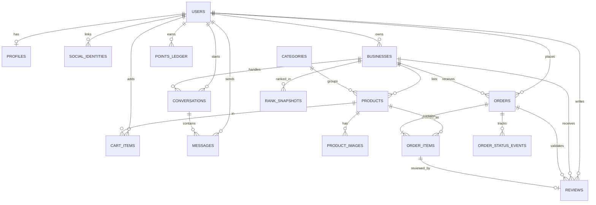

# deliBEE — Database Integration Progress Report

**Project:** deliBEE multi-vendor marketplace
**Repository:** https://github.com/charantadatanan/Delibee
**Report date:** 27 November 2026
**Production:** https://delibee-production-6l26tu.laravel.cloud
**Database:** Laravel Serverless Postgres `delibee-db` (`neon_serverless_postgres`), database/schema `production`, Singapore (`ap-southeast-1`)
**Server version:** PostgreSQL 18.7
**Status:** Integrated; application live on Laravel Cloud
**Prepared by:** Database integration workstream

---

## Key numbers at a glance

| Metric | Value |
|---|---:|
| Migrations applied | 23 / 23 |
| Tables | 29, including `migrations` |
| Indexes | 83 |
| Database CHECK constraints | 7 |
| Production PostgreSQL | 18.7 |
| Businesses / products / product images | 5 / 20 / 20 |
| Orders / reviews / users | 30 / 28 / 25 |

---

## 1. Entity Relationship Diagram

The ERD below is the application-level view of the schema. Framework tables (`migrations`,
`cache`, `cache_locks`, `jobs`, `job_batches`, `failed_jobs`) and Spatie's permission pivot tables
are omitted so the business relationships stay readable. `roles`/`permissions` connect to users
through Spatie's `model_has_roles` and `model_has_permissions` pivots.

### How to read and maintain the ERD

1. **Render it.** GitHub renders the Mermaid block above automatically. For a standalone image,
   paste the same block into <https://mermaid.live> and export SVG/PNG.
2. **Treat migrations as the source of truth.** The ERD describes `database/migrations/`; when a
   migration adds/removes a column or table, update this diagram in the same change.
3. **Check the live shape.** `php artisan migrate:status` and `php artisan delibee:status` confirm
   applied migrations, table/index counts and database size. On Cloud run them through
   `cloud command:run {environment} --cmd='php artisan delibee:status'`.
4. **Inspect a single relationship.** Laravel's `Schema::getForeignKeys('orders')` (tinker) or
   `psql`'s `\d orders` shows the actual constraints behind each line.
5. **Keep credentials out.** The diagram and instructions document structure only; never paste
   `DB_PASSWORD`, connection URLs or bucket keys into the report.

---

## 2. Progress

- **Schema and migrations.** The schema now has **29 tables from 23 migration files**. The original
  21 migrations produced 28 tables; the 27 November auth work adds `users.username`, email
  verification code fields, `profiles.phone_country` and `social_identities`
  (`database/migrations/2026_11_27_085804_add_rafs_auth_fields_to_users_and_profiles.php`,
  `database/migrations/2026_11_27_090932_create_social_identities_table.php`). On Cloud,
  `php artisan migrate:status` reports all 23 as **Ran** in batch 1.
- **PostgreSQL 18 is the only target.** The `pgsql` connection in `config/database.php` reads
  `DB_*`; `.env.example` defaults to `DB_CONNECTION=pgsql`, port 5432 and database `delibee`. Local
  development runs PostgreSQL 18.6; production reports **18.7**. Laravel Cloud injects the Postgres
  connection at runtime; the repository contains no credentials (`.env` is gitignored).
- **Search lives in PostgreSQL.** `database/migrations/2026_10_21_000400_create_products_table.php`
  enables `pg_trgm` and `unaccent`, adds a generated `products.search_vector tsvector` column (name
  weight A, description weight B) with a GIN index, and adds a trigram GIN index on `products.name`.
  `Product::scopeSearch()` uses `websearch_to_tsquery('simple', ...)` plus an `ILIKE` fallback;
  `scopeOrderByRelevance()` ranks with `ts_rank()` (`app/Models/Product.php`).
- **Constraints and indexes back the business rules.**
  `database/migrations/2026_11_09_000000_add_check_constraints.php` adds seven CHECK constraints:
  non-negative product prices/stock, ratings 1–5, positive cart/order-item quantities, non-negative
  item/order amounts. Unique guards cover `users.email`, `users.username`, `businesses.slug`,
  product `(business_id, slug)`, order numbers, review `(user_id, order_item_id)`, cart
  `(user_id, product_id)`, conversation `(business_id, user_id)`, rank snapshots and both
  `social_identities` pairs. `2026_11_08_000100_add_foreign_key_indexes.php` adds eight covering
  indexes; `2026_11_08_000000_add_unique_index_to_reviews_table.php` adds the review guard.
- **Seeders are production-safe.** `database/seeders/DatabaseSeeder.php` always runs `RoleSeeder`
  (3 roles, 5 permissions) and `CategorySeeder` (7 categories), both idempotent, then returns before
  demo data when `app()->isProduction()`. `DemoSeeder` defines the 5-business, 30-order, 28-review
  set; `DemoPhotoSeeder` writes photos to `Storage::disk('public')`. The standard deploy seed does
  not recreate demo rows in production; the live snapshot already contains the demonstration set.
- **Sessions, cache and queues use Postgres.** `sessions`, `cache`, `cache_locks`, `jobs`,
  `job_batches` and `failed_jobs` come from the `0001_01_01_*` migrations. Production sets
  `SESSION_DRIVER=database`, `CACHE_STORE=database` and `QUEUE_CONNECTION=database`.
  `delibee:prune` clears old sessions and failed jobs daily at 03:05 (`routes/console.php`).
- **Object storage is attached.** Public bucket `delibee-public` is the default `public` disk;
  `league/flysystem-aws-s3-v3` and `config/filesystems.php` wire it up. The database stores relative
  paths under `products/*.jpg`; the bytes live in the bucket, not in Postgres.
- **Deployment.** `main` deploys to the `production` environment with
  `php artisan migrate --force && php artisan db:seed --force`; the live site runs the current
  `main` and Cloud injects the Postgres and bucket values. See
  `docs/guides/laravel-cloud.md`.

---

## 3. How the database communicates with each module

All modules use Laravel's Eloquent/query builder over the single `pgsql` connection injected by
Cloud. There is no second datastore for business data; Redis is not attached.

| Module | Reads / writes | Communication and rules |
|---|---|---|
| **Storefront marketplace** | `products`, `businesses`, `categories`, `product_images` | Eloquent models in `app/Livewire/Storefront/Marketplace.php`, `ProductDetails.php`, `BusinessProfile.php`; only active businesses/products are exposed; storage paths become bucket URLs. Search uses the generated `search_vector` + `ts_rank`. |
| **Accounts & authentication** | `users`, `profiles`, `social_identities`, `sessions`, `password_reset_tokens`, `roles`, `permissions` | Fortify actions/controllers (`app/Actions/Fortify/CreateNewUser.php`, `app/Providers/FortifyServiceProvider.php`); Eloquent writes user + profile + customer role; verification code hash/expiry live on `users`; Spatie reads role pivots; sessions are database-backed. |
| **Customer account** | `orders`, `order_items`, `reviews`, `points_ledger`, `cart_items` | `User` relations and dashboard/reviews/rewards pages; totals and balances are derived from ledger/order rows, not duplicated counters. |
| **Cart & checkout** | `cart_items`, `products`, `orders`, `order_items`, `order_status_events` | `app/Services/CartService.php` and `CheckoutService.php`; checkout runs in a DB transaction and locks product rows with `lockForUpdate` before reducing stock; it creates one order per seller. |
| **Bee Flight orders** | `orders`, `order_items`, `order_status_events`, `businesses` | Customer/seller order pages read the order and its timeline; cancellation restores stock and reverses the purchase points once. |
| **Honey Rewards** | `points_ledger` | `app/Services/PointsService.php` appends one row per award/reversal; balances are sums of the ledger, never a stored balance. |
| **Verified reviews** | `reviews`, `orders`, `order_items` | Only delivered order items can be reviewed; unique `(user_id, order_item_id)` prevents duplicates; published reviews feed ratings/BeeRank. |
| **Bee Chat** | `conversations`, `messages`, `users`, `businesses` | Livewire chat pages read/write conversation and message rows; per-user rate limits are enforced in the component/request path. |
| **Seller desk** | `businesses`, `products`, `orders`, `order_items`, `order_status_events` | Seller pages scope every query by the authenticated owner's business; product/stock changes and fulfilment updates are transactional where needed. |
| **Hive Guard** | `businesses`, `orders`, `reviews` | Admin-only middleware; approval/suspension changes `businesses.status`, which immediately affects storefront/rank queries; review moderation changes `reviews.status`. |
| **BeeRank** | `rank_snapshots`, `businesses`, `orders`, `reviews`, `messages` | `app/Services/BeeRankService.php` aggregates the rolling 30-day signals and writes monthly/yearly snapshots; the scheduler runs `bee:rank` on the first of the month and on 1 January. |
| **Scheduler / housekeeping** | `sessions`, `failed_jobs`, `rank_snapshots` | `routes/console.php` schedules ranking and `delibee:prune`; Cloud runs `schedule:run` every minute on the app instance. |
| **Object storage** | `product_images.path`, business logo paths, profile avatar paths | Database stores paths; `Storage::url()` resolves them through the default `public` disk (`delibee-public`). The bucket is not a database and holds no relational data. |

---

## 4. Cloud deployment and database

| Item | Production value |
|---|---|
| Application / environment | `delibee` / `production` |
| Public URL | https://delibee-production-6l26tu.laravel.cloud |
| Region | Singapore (`ap-southeast-1`) |
| Runtime | PHP 8.5, Node 24 |
| Compute | App instance `flex-512mb`, 1 replica, hibernation enabled |
| Database cluster | `delibee-db`, Laravel Serverless Postgres (`neon_serverless_postgres`) |
| Database/schema | `production` |
| PostgreSQL | 18.7 |
| Connection | Cloud injects `DB_HOST`, `DB_PORT`, `DB_USERNAME`, `DB_PASSWORD`, `DB_DATABASE`; application sets `DB_CONNECTION=pgsql` |
| Deploy command | `php artisan migrate --force && php artisan db:seed --force` |
| Build command | Composer install, `npm ci`, Vite build, `php artisan optimize` |
| Object storage | Public bucket `delibee-public`, default `public` disk |
| Sessions / cache / queue | Database drivers on the same Postgres cluster |
| Scheduler | Enabled on the App instance (`schedule:run` every minute) |
| Health check | `/up` returns HTTP 200 |
| Backups / PITR | PITR supported; current retention is 1 day; no manual snapshots; latest app-level backup `none` |

The application never stores a database DSN or password in Git. Cloud's injected values are read by
`config/database.php`; the public bucket is resolved by `config/filesystems.php`. The database
cluster and bucket are in the same Singapore region as the application.

---

## 5. Final output

The production database/schema is the 23-migration schema, organised as follows:

| Domain | Tables | Count |
|---|---|---:|
| Identity and access | `users`, `password_reset_tokens`, `sessions`, `profiles`, `social_identities`, `roles`, `permissions`, `model_has_roles`, `model_has_permissions`, `role_has_permissions` | 10 |
| Marketplace | `businesses`, `categories`, `products`, `product_images` | 4 |
| Commerce | `cart_items`, `orders`, `order_items`, `order_status_events`, `reviews` | 5 |
| Loyalty and ranking | `points_ledger`, `rank_snapshots` | 2 |
| Chat | `conversations`, `messages` | 2 |
| Framework infrastructure | `migrations`, `cache`, `cache_locks`, `jobs`, `job_batches`, `failed_jobs` | 6 |
| **Total** | | **29** |

Production data snapshot, 27 November 2026:

| Table | Rows | Notes |
|---|---:|---|
| `users` | 25 | 2 admins, 10 sellers, 13 customers, 0 roleless |
| `businesses` | 5 | 4 active; 1 pending and hidden from the storefront |
| `categories` | 7 | Seeded marketplace categories |
| `products` | 20 | Catalogue rows, PHP pricing |
| `product_images` | 20 | Photos served from `delibee-public` |
| `orders` | 30 | One order per seller per checkout |
| `reviews` | 28 | Verified-purchase reviews only |

The storefront reads this data live. The marketplace returns the four active businesses and their
products; the pending business is not exposed. Image URLs resolve from the Cloud bucket. A live
Gmail SMTP test and registration OTP were also confirmed, so account rows can now complete the
verification flow that updates `users.email_verified_at`.

---

## 6. Verification

| Check | Result |
|---|---|
| Deployment | Current `main` deployed successfully to `delibee` / `production`; push-to-deploy enabled |
| Migrations | `php artisan migrate:status` — **23 / 23 Ran**, batch 1 |
| Database status | `php artisan delibee:status` — database `production`; PostgreSQL **18.7**; 10,208 kB; **29 tables**; **83 indexes**; **23 migrations**; 0 pending/failed jobs |
| Row counts | `users` 25, `businesses` 5, `products` 20, `product_images` 20, `orders` 30, `reviews` 28 |
| Search read path | `/marketplace?search=honey` returns matching `Wild Honey` products and bucket images |
| Marketplace read path | `/marketplace`, `/ranking`, `/login`, `/up` return HTTP 200; active shops and products render |
| Object storage | `products/fresh-apples.jpg` from `delibee-public` returns HTTP 200 `image/jpeg` |
| Extensions/search objects | `pg_trgm`, `unaccent`, generated `tsvector` and both GIN indexes are applied; `Product::scopeSearch()`/`scopeOrderByRelevance()` are the live path |
| Integrity rules | Seven CHECK constraints, unique guards and FK indexes are present; 83 indexes reported |
| Backup / PITR | `supportsPitr: true`; `earliestRestoreTime` 2026-11-27 12:59:40 UTC; `retention_days: 1`; no manual snapshots |
| CI guardrail | `.github/workflows/ci.yml` provisions PostgreSQL 18 for the migration suite and tests |

---

## 7. Open items

1. **No application-level backup runbook on Cloud.** The verified dump/restore scripts under
   `scripts/backup/` read `DB_*` from a local `.env` and write to `storage/backups`; they are not
   scheduled against `delibee-db`. `delibee:status` reports `latest backup: none`. Define a
   Cloud-safe dump path, schedule, destination, owner and retention, then re-run the restore drill
   against the 23-migration schema.
2. **PITR and retention settings need an explicit decision.** PITR is available, but the current
   metadata reports a one-day retention and there are no manual snapshots. Confirm this meets the
   production RPO/RTO, extend it if required, and document the restore procedure next to
   `docs/operations/database-operations.md`.
3. **No live custom domain.** Production is served from the `laravel.cloud` hostname.
   `Delibee.com.ph` has been added in Laravel Cloud, but hostname, SSL and origin checks are still
   pending.
4. **Keep the ERD in sync.** Update the Mermaid block whenever a migration changes a table or
   relationship; add it to the review checklist for schema pull requests.

---

**Primary references:** `docs/guides/laravel-cloud.md`,
`docs/operations/database-operations.md`, `database/migrations/`, `database/seeders/`,
`config/database.php`, `config/filesystems.php`, `routes/console.php`, `app/Models/Product.php`,
`app/Services/BeeRankService.php`, `app/Services/CheckoutService.php`, `app/Services/PointsService.php`,
`app/Console/Commands/DatabaseStatus.php`, `.github/workflows/ci.yml`.
